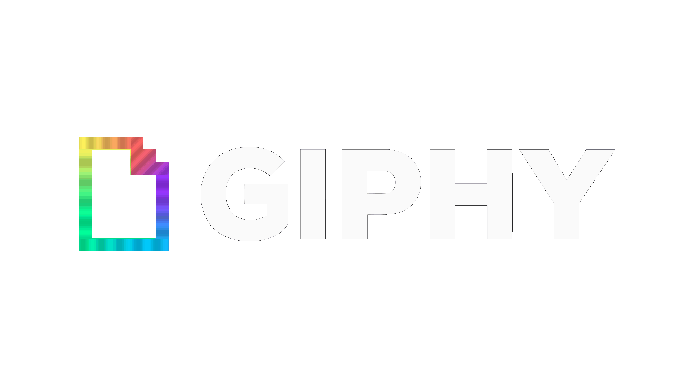

# Giphy Downloader



A dark-themed, single-page web app for finding and saving Giphy content. Search GIFs, paste any Giphy GIF or Sticker link, browse a whole Giphy profile (`@username`), select what you like, and download a single link or a whole batch as a ZIP.

Built and maintained by **[Xeloria](https://github.com/xeloria)** on GitHub.

## Features

- **Search Giphy** — type any query (`happy dance`) to browse matching GIFs.
- **One GIF or Sticker link** — paste a Giphy URL (`giphy.com/gifs/...`, `giphy.com/stickers/...`, `media.giphy.com`, `i.giphy.com`, or `/embed/`) to get its direct link instantly.
- **Profile browsing** — open `giphy.com/channel/<name>` or type `@<username>` to load every GIF and Sticker on a profile, in one merged view.
- **Filter tabs** — All / GIFs / Stickers with live counts for profile browsing.
- **Infinite scroll** — more results load automatically as you approach the end of the grid; no buttons.
- **HD previews** — grid cards use Giphy's ~320 px renditions so thumbnails stay crisp instead of pixelated.
- **Selection tools** — check cards individually, or use Select All Visible / Deselect All, with always-on "selected / visible" counters.
- **Bulk ZIP download** — bundle up to **500 items** into one ZIP using JSZip (STORE mode, so already-compressed GIF data stays fast and memory-friendly), with a live progress bar, size estimate, and a confirmation prompt before very large batches.
- **Single downloads** — every card has Copy Link and Download buttons; the sidebar offers a persistent direct link with copy/download too.
- **Bring your own API key** — app defaults to a public demo key (rate-limited), but you can paste your own in the API settings panel; it is stored locally only (`localStorage`).
- **Fully responsive** — wide workspace layout on desktop with a sidebar, tidy stacked controls on mobile.

## Getting started

No build step and no dependencies to install.

1. Download or clone the repository.
2. Open `index.html` in your browser.

For the smoothest experience (clipboard permissions, etc.), serve it locally instead:

```sh
python -m http.server 8000
# or
npx serve
```

…then visit `http://localhost:8000`.

## Usage

| You type | You get |
| --- | --- |
| `happy dance` | GIF search results |
| `@username` | The profile's GIFs + Stickers |
| `giphy.com/gifs/slug-id` or `giphy.com/stickers/...` | Direct link to that GIF |
| `media.giphy.com/media/<id>/giphy.gif` | Direct link to that GIF |

Once results load:

1. Browse and filter the grid (All / GIFs / Stickers tabs on profiles).
2. Check the cards you want — or Select All Visible.
3. Hit **Download Selected as ZIP**, **Download All as ZIP**, or download per-card.

ZIP notes:

- Batches are capped at 500 items; the ZIP dialog tells you the estimated file size up front.
- Very large batches (~900 MB+) ask for confirmation first, since everything is assembled in browser memory.
- Downloads pull files straight from `media.giphy.com`, so no extra authentication is needed.
- The ZIP name reflects your search or profile (e.g. `neilsanders_all_96.zip`).

## API key

The app ships with a public demo key, but it is rate-limited. For best results:

1. Get a free key at [developers.giphy.com](https://developers.giphy.com/).
2. Open **API Key settings** in the sidebar, paste it, and hit Save.
3. Reload the profile or search — it will re-fetch with your key.

Your key never leaves your browser (stored in `localStorage`). **Reset** switches back to the demo key.

## Project structure

```
index.html          Single-page UI (Bootstrap 4 + local styling)
css/style.css       Dark-theme stylesheet (workspace sidebar, grid, controls)
css/reset.css       Eric Meyer's public-domain CSS reset
js/app.js           All app logic: URL parsing, Giphy API, grid, selection, ZIP
img/                App imagery
package.json        Project metadata (name, author, repository links)
```

## Not supported

- `gph.is` short links (they are redirects, not media IDs) — open one and copy the full `giphy.com` URL instead.
- Clips pages (`giphy.com/clips/...`) — those are MP4-only renditions; GIF and Sticker links work fine.

## License

© 2026 Xeloria. All rights reserved.

## Disclaimer

This project uses the public Giphy API and is not affiliated with Giphy. Please respect content owners' rights when downloading and reusing GIFs.
